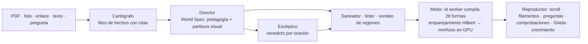

# EIDOS — Toda idea tiene forma.

EIDOS convierte un PDF, una foto, un enlace, un texto o una pregunta en un **mundo**: una película de hasta
160 000 partículas que se recorre con el scroll, narrada a tu nivel, donde cada oración lleva de vuelta al pasaje
exacto de tu fuente.

*[Read in English](README.md)* · Córrelo en tu equipo y abre [`/pitch`](http://localhost:3000/pitch) para la
presentación.

## Qué hace

- **Forja** — un equipo de agentes de Claude lee tu fuente, extrae un libro de hechos con citas nativas, diseña un
  recorrido de aprendizaje y lo escribe como una partitura visual que el motor ejecuta. Los ves trabajar en el
  Teatro de Forja.
- **Explora** — cada escena se transforma desde la anterior: la transformación misma muestra la relación entre
  ideas. Las anotaciones señalan las partes que nombran; las perillas cambian un parámetro y la forma responde.
- **Verifica** — cada oración termina en un filamento: verde abre el pasaje citado, gris marca conocimiento
  general, violeta marca un escenario hipotético.
- **Pregunta y bifurca** — toca cualquier parte de una forma y pregunta "¿qué es esto?"; el Tutor responde con
  citas. Pregunta "¿Y si…?" y crece una rama hipotética.
- **Crece** — las comprobaciones detienen el paso con suavidad; una respuesta incorrecta agrieta el mundo y crece
  un capítulo nuevo para tu malentendido, seguido de una comprobación más sencilla. El final es una Constelación de
  lo que dominas.

## Por qué importa

En PISA 2025, alrededor de cuatro de cada diez estudiantes mexicanos de quince años quedaron por debajo del nivel
básico en matemáticas, lectura y ciencias a la vez (41.8 %, frente a 19.7 % de promedio OCDE), con 388 puntos en
matemáticas frente a 463 de la OCDE
([Por Esto, 8 sep 2026](https://www.poresto.com/mexico/2026/9/8/mexico-retrocede-en-pisa-2025-baja-en-matematicas-y-418-de-estudiantes-queda-debajo-del-nivel-basico.html)).

El mismo informe muestra que ocho de cada diez de esos estudiantes dicen sentir curiosidad por distintos temas,
más que el 73 % del promedio internacional
([La Razón, 9 sep 2026](https://www.razon.com.mx/mexico/2026/09/09/revela-pisa-deuda-en-aprendizaje-y-que-aun-impacta-brecha-economica/)).
Las ganas están; las herramientas son planas, pasivas y no verificables. EIDOS apuesta por herramientas
espaciales, adaptativas y honestas con sus fuentes.

## Cómo usa Claude

| Capacidad | Para qué | Dónde |
|---|---|---|
| Citas nativas | Cada hecho del libro y cada respuesta del Tutor apunta a un pasaje exacto | `src/server/forge/runForge.ts`, `src/server/agents/live.ts` |
| Files API | Los PDF se suben una vez con expiración de 24 h y los reusan el Tutor y el Escéptico | `src/server/ingest/index.ts` |
| Búsqueda y lectura web | Modos Pregunta y Enlace | `src/server/ingest/index.ts` |
| Salidas estructuradas | El World Spec, veredictos, calificaciones, remediales y reescrituras de la Lente | `src/lib/world/schema.ts`, `src/server/agents/live.ts` |
| Pensamiento adaptativo | Resúmenes en vivo en el Teatro de Forja | `src/server/ai/claude.ts` |
| Visión | Modo Foto (el Lector) | `src/server/forge/runForge.ts` |
| Uso de herramientas | El Tutor proyecta una forma en la escena | `src/server/agents/live.ts` |
| Caché de prompts (1 h) | Prompts de sistema y documentos fuente | `src/server/agents/prompts.ts` |
| Fallbacks ante rechazos | Peticiones a Opus 5.5 y Sonnet 5.5 | `src/server/ai/claude.ts`, `src/server/ai/models.ts` |

Agentes y modelos: Cartógrafo y Director en Opus 5.5; Escéptico y Tutor en Sonnet 5.5; Evaluador y Lente en
Haiku 5.5; Jardinero y Bifurcador en Opus 5.5. Detalles en [docs/CLAUDE_USAGE.md](docs/CLAUDE_USAGE.md).

## Arquitectura



Más diagramas en [docs/ARCHITECTURE.md](docs/ARCHITECTURE.md).

## Inicio rápido

```bash
pnpm install
cp .env.example .env.local   # agrega ANTHROPIC_API_KEY (opcional: el Modo Demo funciona sin ella)
pnpm dev
```

Abre http://localhost:3000. Requiere Node 22+ y pnpm.

## Modo Demo y piloto automático

- **Sin clave de API** (o sin conexión, o con `?demo=1`) EIDOS funciona en Modo Demo: la consola lleva las
  preguntas a los cinco mundos de demostración, el Teatro de Forja reproduce repeticiones etiquetadas
  "Repetición · sintetizada", y las comprobaciones, la Grieta, los capítulos remediales, las respuestas del Tutor,
  las ramas y la Lente usan recursos precompuestos en cada mundo.
- **Piloto automático**: `Shift + D` en cualquier pantalla, o abre `/?autopilot=1`. Conduce la interfaz real
  esperando condiciones reales. `Esc` lo detiene. En `/pitch` avanza las diapositivas.
- **Atajos** (pulsa `?`): `J`/`K` o flechas · `/` preguntar · `L` Lente · `R` modo lectura · `S` sonido ·
  `P` presentación · `F` pantalla completa · `B` pantalla negra (pitch) · `Shift + D` piloto · `Esc` cerrar.

## Scripts y calidad

La tabla completa de scripts y los resultados de calidad (pruebas unitarias, end-to-end en Chromium y WebKit,
evaluación estática de los cinco mundos, accesibilidad y rendimiento) están en el [README en inglés](README.md).
El reporte de evaluación está en [evals/report.md](evals/report.md).

## Privacidad

Los PDF van a la Files API de Claude con expiración de 24 horas; EIDOS no guarda documentos ni mundos en su
servidor; el token de sesión está cifrado (AES-256-GCM) y expira en 24 horas; los registros solo contienen
metadatos operativos. Los mundos que forjas se quedan en tu navegador. Ver [docs/PRIVACY.md](docs/PRIVACY.md).

## Créditos y licencia

Tipografías Bodoni Moda y Atkinson Hyperlegible Next y Mono (SIL Open Font License); ruido simplex según Stefan
Gustavson e Ian McEwan; three.js, postprocessing, GSAP, Lenis y las demás bibliotecas de
[docs/CREDITS.md](docs/CREDITS.md), cada una con su licencia. El código propio de EIDOS se publica con
[licencia MIT](LICENSE).
