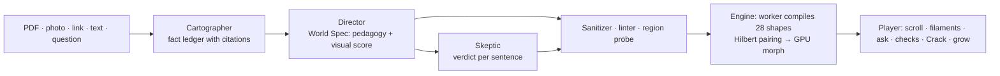

# EIDOS — Every idea has a shape.

EIDOS turns a PDF, a photo, a link, a text or a question into a **world**: a scroll-driven film of up to 160 000
particles, narrated at your level, where every sentence leads back to the exact passage of your source.

*[Leer en español](README.es.md)* · Run it locally and open [`/pitch`](http://localhost:3000/pitch) for the
presentation.

## What it does

- **Forge** — a team of Claude agents reads your source, extracts a fact ledger with native citations, designs a
  learning journey and writes it as a visual score the engine plays. You watch them work in the Forge Theater.
- **Explore** — each scene morphs out of the previous one, so the transformation itself shows how ideas relate.
  Annotations point at the parts they name; knobs change a parameter and the form responds.
- **Verify** — every sentence ends in a filament: green opens the cited passage, grey marks general knowledge,
  violet marks a hypothetical scenario.
- **Ask & Branch** — tap any part of a form and ask "what is this?"; the Tutor answers with citations. Ask
  "¿Y si…?" and a hypothetical branch grows.
- **Grow** — checks hold the way softly; a wrong answer cracks the world and a new chapter grows for your specific
  misconception, followed by a simpler check. The finale is a Constellation of what you have mastered.

## Why it matters

In PISA 2025, about four in ten Mexican fifteen-year-olds scored below the basic level in maths, reading and
science at the same time (41.8 % against an OECD average of 19.7 %), with 388 points in maths against the OECD's
463 ([Por Esto, 8 Sep 2026](https://www.poresto.com/mexico/2026/9/8/mexico-retrocede-en-pisa-2025-baja-en-matematicas-y-418-de-estudiantes-queda-debajo-del-nivel-basico.html)).

The same report shows that eight in ten of those students say they feel curious about different subjects, more
than the international average of 73 %
([La Razón, 9 Sep 2026](https://www.razon.com.mx/mexico/2026/09/09/revela-pisa-deuda-en-aprendizaje-y-que-aun-impacta-brecha-economica/)).
The will to learn is there; the tools are flat, passive and unverifiable. EIDOS is a bet on tools that are
spatial, adaptive and honest about their sources.

## How it uses Claude

| Capability | What for | Where |
|---|---|---|
| Native citations | Every fact in the ledger and every Tutor answer points at an exact passage | `src/server/forge/runForge.ts`, `src/server/agents/live.ts` |
| Files API | PDFs uploaded once with a 24-hour expiry, reused by the Tutor and Skeptic | `src/server/ingest/index.ts` |
| Web search and web fetch | Question and link modes | `src/server/ingest/index.ts` |
| Structured outputs | The World Spec, verdicts, grades, remedial beats and lens rewrites | `src/lib/world/schema.ts`, `src/server/agents/live.ts` |
| Adaptive thinking | Streamed as summaries into the Forge Theater | `src/server/ai/claude.ts` |
| Vision | Photo mode (the Reader) | `src/server/forge/runForge.ts` |
| Tool use | The Tutor projects a shape into the scene | `src/server/agents/live.ts` |
| Prompt caching (1 h) | System prompts and source documents | `src/server/agents/prompts.ts` |
| Server-side refusal fallbacks | Opus 5.5 and Sonnet 5.5 requests | `src/server/ai/claude.ts`, `src/server/ai/models.ts` |

Agents and models: Cartographer and Director on Opus 5.5, Skeptic and Tutor on Sonnet 5.5, Evaluator and Lens on
Haiku 5.5, Gardener and Brancher on Opus 5.5. Details in [docs/CLAUDE_USAGE.md](docs/CLAUDE_USAGE.md).

## Architecture



More diagrams (SSE events, the growth loop, the GPU pipeline and the persistent canvas) in
[docs/ARCHITECTURE.md](docs/ARCHITECTURE.md).

## Quickstart

```bash
pnpm install
cp .env.example .env.local   # add ANTHROPIC_API_KEY (optional: Demo Mode works without it)
pnpm dev
```

Open http://localhost:3000. Requires Node 22+ and pnpm.

## Demo Mode & Autopilot

- **Without an API key** (or offline, or with `?demo=1`) EIDOS runs in Demo Mode: the console sends questions to
  the five demo worlds, the Forge Theater plays replays labelled "Repetición · sintetizada", and checks, the Crack,
  remedial chapters, Tutor answers, branches and the Lens use precomposed assets stored in each world.
- **Autopilot**: press `Shift + D` anywhere, or open `/?autopilot=1`. It drives the real interface — landing,
  console, forge, world walk, a filament, Ask the scene, a wrong answer with the Crack and a remedial chapter, the
  Lens, the finale and the Engine Room — waiting on real conditions. `Esc` stops it. On `/pitch` it advances the
  slides.
- **Shortcuts** (press `?`): `J`/`K` or arrows next/previous beat · `/` ask · `L` lens · `R` reading mode ·
  `S` sound · `P` presentation · `F` full screen · `B` black screen (pitch) · `Shift + D` autopilot · `Esc` close.

## Scripts

| Script | What it does |
|---|---|
| `dev` / `build` / `start` | Next.js |
| `typecheck` · `lint` · `format` | TypeScript, ESLint, Prettier |
| `test` / `test:watch` | Vitest |
| `e2e` | Playwright against the production build (Chromium and WebKit, desktop and mobile) |
| `catalog` | Regenerates the shape catalog injected into prompts |
| `schema:check` | Checks the API schemas follow structured-output rules (and compile on the API with a key) |
| `worlds:check` | Strict schema, sanitizer, pedagogical linter and shape generation for every world |
| `demo:cite` | Computes `char` citations for demo worlds from literal quotes |
| `bake` | Forges a world from `content/sources/` with the real pipeline (needs a key) |
| `record-replay` / `synth-replay` | Records a real forge replay (needs a key) / synthesizes one from a world |
| `shots` / `posters` | Deterministic QA screenshots / Atlas posters and Open Graph cards |
| `smoke:live` | Live smoke test with a 2 USD hard cap (needs a key) |
| `eval` | Evaluation harness (static; live with `EVAL_LIVE=1` and a key) |
| `bench` | Engine benchmarks: shapes, composition, pairing, picking |
| `lighthouse` | Lighthouse on the production build |
| `audit:placeholders` | Leftover work markers or filler text, buttons without an action, broken internal links |

## Quality

- **Unit tests** (Vitest): every shape is tested for exact count, no NaN, extent, regions and determinism at
  16 384 and 160 000 particles, plus the sanitizer, linter, ParaMath, SSE parsing, the forge pipeline (with
  fixtures shaped like API events), the session token, pricing and more.
- **End-to-end** (Playwright, production build, Chromium and WebKit, desktop 1440 × 900 and mobile 390 × 844):
  landing, every beat of every demo world, filaments, the Crack and growth, the Lens, the Demo Mode forge,
  reading mode with print layout, share links, reduced motion, no WebGL, axe on every route, the CSP and a full
  autopilot run.
- **Evaluation** (`pnpm eval`, static mode, the five demo worlds):

  | World | Lint | Sentences cited | Ledger used | Readability (range) |
  |---|---|---|---|---|
  | Donde el espacio se curva | 100 | 90.5 % | 97.4 % | 72 (55–75) |
  | El ajolote, maestro de la regeneración | 100 | 90.7 % | 95 % | 75 (≥ 65) |
  | La fábrica de luz | 100 | 88.9 % | 87.5 % | 76 (≥ 65) |
  | El interés que gana interés | 100 | 92.9 % | 97.5 % | 71 (55–75) |
  | Cómo piensa un Transformer | 100 | 93.5 % | 92.5 % | 72 (55–75) |

  Full report in [evals/report.md](evals/report.md). Live metrics (Skeptic support, latency, cost, an independent
  judge) need an API key and have not been run yet.
- **Accessibility**: narration in the DOM, a text description for every scene, full keyboard support, reduced
  motion, voice narration, printable reading mode; axe reports no serious or critical violations.
- **Performance**: four quality tiers (160 000 / 80 000 / 35 000 / 16 000 particles) with live degradation;
  `?perf=1` shows fps, frame time, particles, tier and DPR.

## Project structure

```
src/
  app/          routes: / · /forja/[sessionId] · /m/[worldId] (+ /leer) · /atlas · /pitch · /lab · /s · api/*
  engine/       particle engine: shapes/ (28 generators + registry) · paramath/ · compile/ · field/ · shaders/
                camera/ · scroll/ · stage/ · interaction/ · figure/ · audio/ · quality/
  server/       Claude client, agents, forge orchestration, ingest, session tokens, limits, sharing
  lib/          World Spec types and Zod schemas, sanitizer, pedagogical linter, readability, SSE, storage, i18n
  components/   landing · console · theater · player · reading · atlas · pitch · lab · ui
  demo/         autopilot, offline grader
public/worlds/  demo worlds (+ index.json) · public/replays/ forge replays · public/posters/ · public/og/
content/sources demo-world source texts and authoring notes
e2e/ · evals/ · scripts/ · docs/
```

## Privacy

PDFs go to the Claude Files API with a 24-hour expiry; EIDOS stores no documents or worlds on its server; the
session token that lets you keep asking about your PDF is encrypted (AES-256-GCM) and expires in 24 hours; logs
contain only operational metadata. Worlds you forge stay in your browser. See [docs/PRIVACY.md](docs/PRIVACY.md).

## More

[Architecture](docs/ARCHITECTURE.md) · [Claude usage](docs/CLAUDE_USAGE.md) · [Pedagogy](docs/PEDAGOGY.md) ·
[Design](docs/DESIGN.md) · [Pitch](docs/PITCH.md) · [Demo video](docs/DEMO_VIDEO.md) ·
[Judges' FAQ](docs/JUDGES_FAQ.md) · [Submission](docs/SUBMISSION.md) · [Roadmap](docs/ROADMAP.md) ·
[Decisions](DECISIONS.md)

## Credits & license

Typefaces Bodoni Moda and Atkinson Hyperlegible Next and Mono (SIL Open Font License); simplex noise after Stefan
Gustavson and Ian McEwan; three.js, postprocessing, GSAP, Lenis and the other libraries listed in
[docs/CREDITS.md](docs/CREDITS.md) under their own licenses. EIDOS's own code is released under the
[MIT license](LICENSE).
