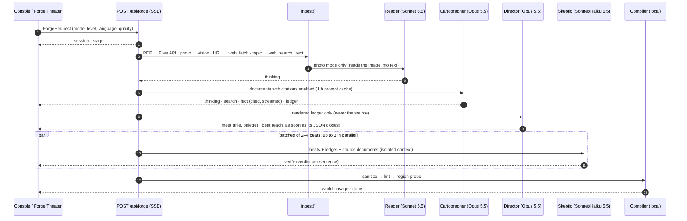
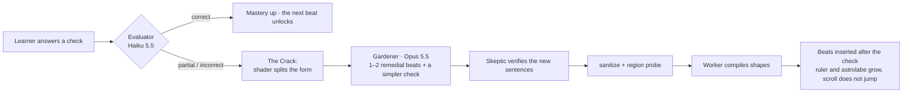
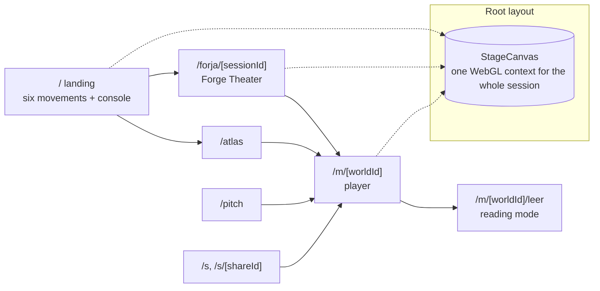

# Architecture

EIDOS has two halves that only meet through a typed contract, the **World Spec**:

- a **server pipeline** of Claude agents that turns a source into a fact ledger with citations and a World Spec
  that only uses facts from that ledger;
- a **client engine** (Morfogénesis) that turns a World Spec into a scroll-driven particle film, entirely in the
  browser, without ever executing model output as code.

Every boundary is validated with Zod; every error is an `EidosError` with an `EIDOS_E_*` code.

## 1. The forge pipeline and its SSE events



`src/server/forge/runForge.ts` is the orchestration; `src/lib/sse/*` the protocol (`session, stage, thinking,
search, fact, ledger, meta, beat, verify, world, usage, error, done`). The same reducer
(`src/lib/forge/session.ts`) consumes live events and recorded replays, so the Theater cannot tell them apart.

## 2. Check → Evaluator → Gardener → Skeptic → compiler → insertion



In Demo Mode the Evaluator is the offline grader (`src/demo/offlineGrader.ts`) and the Gardener is replaced by the
remedial beats precomposed in each world (`demoAssets.remedials`), shown with the same animation.

## 3. The engine: textures, GPGPU, render, post-processing

```mermaid
flowchart TB
  subgraph Worker[Web Worker · Comlink]
    G1[28 shape generators<br/>registry.ts] --> G2[composeScene<br/>layers + dust + colour]
    G2 --> G3[Hilbert pairing<br/>prev ↔ next]
    G3 --> G4[stagger delays]
  end
  G4 -- transferable buffers --> T[Data textures per beat:<br/>from · to · aux · colour · transition]
  subgraph GPU[WebGL2 · three.js]
    T --> V[Vertex shader: morphBase()<br/>deterministic, scroll-driven]
    CUR[GPGPU cursor layer<br/>GPUComputationRenderer] --> V
    V --> P[Points]
    P --> PP[postprocessing:<br/>bloom · chromatic aberration · noise · vignette · AgX]
  end
  SC[ScrollConductor<br/>Lenis on the GSAP ticker] -- global progress P = i + s --> V
  QM[QualityManager<br/>tiers 3 → 0, 2 s FPS window] --> GPU
```

- A beat's morph is a pure function of scroll progress: scrolling back plays it backwards exactly.
- Positions never round-trip through React; the Stage class owns the renderer and React only orchestrates.
- Tiers: 160 000 / 80 000 / 35 000 / 16 000 particles, degrading DPR, density, effects and tier when the 2 s FPS
  window drops.
- Motion is per layer (`aux.r = motionType + 8·layer`) around per-layer pivots, so a rotating helix and a still
  chart can share a beat.

## 4. Routes over a persistent canvas



The canvas is mounted once in the root layout, so navigating from the landing to the theater to a world morphs the
same particles instead of reloading a 3D scene. Reading mode renders still figures on the CPU
(`src/engine/figure/renderFigure.ts`), which is also the no-WebGL fallback.

## Key decisions

The full log with rejected alternatives is in [`DECISIONS.md`](../DECISIONS.md). The ones that shape the code most:

| Decision | Why |
|---|---|
| Vanilla three.js + `postprocessing`, not React Three Fiber | The engine must live outside React and never push per-frame data through it; one persistent `Stage` class owns WebGL, GPGPU and context loss. |
| ParaMath, a closed expression language | Claude can write `y = sin(3*t)` for a curve or a surface, but nothing it writes is ever evaluated as JavaScript. |
| Text and glyphs rasterized in pure TypeScript | Identical output in Node, workers and every browser, which deterministic replays, QA shots and tests need. |
| Director sees only the ledger | It cannot cite what the Cartographer did not extract with a citation. |
| Skeptic in an isolated context | It verifies sentences against the source without the Director's reasoning. |
| Sanitizer clamps instead of rejecting | A parameter out of range or an unknown region id is repaired and reported, so one slip never blanks a world. |
| CSP with a per-request nonce | Scripts are pinned to the nonce with `strict-dynamic`; eval only in development. |
