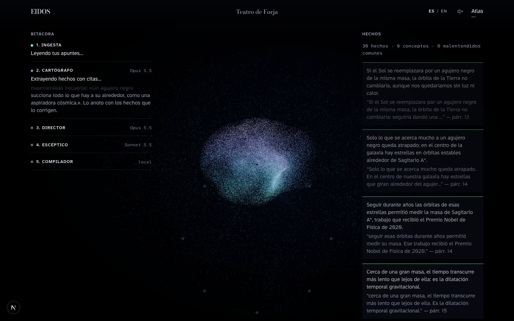
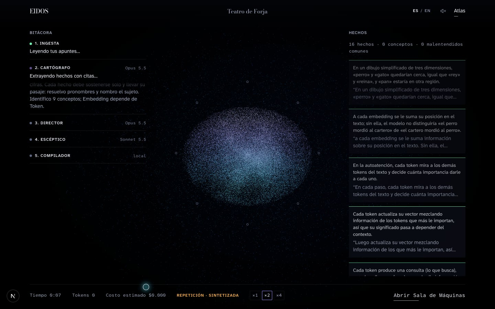

# Design: the "Observatorio" system

EIDOS looks like an **editorial night observatory**: darkness is the canvas, light is the protagonist, and the type
has the poise of a good science magazine. The interface behaves like a **precision instrument** — rulers, ticks,
dials and hairlines, never fat buttons or glass cards. The interface is almost monochrome; **colour lives in the
particles**, and every world brings its own palette of light.

Three guiding words: **luminous, precise, alive.**

## Tokens

All values live in [`src/styles/tokens.css`](../src/styles/tokens.css).

| Group | Tokens |
|---|---|
| Ink (backgrounds) | `--ink-0 #04050A` · `--ink-1 #0A0C14` · `--ink-2 #121521` · `--ink-3 #1B1F2E` |
| Text | `--text-1 #E9ECF5` · `--text-2 #9AA3B8` · `--text-3 #7A849C` |
| Signals (meaning, never decoration) | truth `#6CF5B0` · partial `#FFB547` · crack `#FF5C7A` · general `#C9CEDC` · hypothetical `#B79CFF` · focus `#5BE7FF` |
| Radius | controls 2 px · panels 4 px (nothing above 4 px) |
| Spacing | 4-px scale: 4, 8, 12, 16, 24, 32, 48, 64, 96, 128 |
| Motion | `--ease-out-expo` for arrivals, `--ease-in-out-quint` for morphs and long moves |

### World palettes (light, in the particles)

| Palette | Primary → secondary → accent → glow | Used by |
|---|---|---|
| aurora | `#7CF7D4` `#5BC8FF` `#A78BFA` `#F0F6FF` | landing, pitch, Transformer |
| nebulosa | `#FF7AD9` `#8B5CF6` `#38BDF8` `#FDF4FF` | black holes |
| solar | `#FFD166` `#FF9F1C` `#FF4D6D` `#FFF3D6` | photosynthesis |
| jade | `#00C2A8` `#7BE495` `#2EE6D6` `#E8FFF6` | compound interest |
| bioluz | `#39FF88` `#00E0B8` `#B6FF5C` `#EFFFF4` | axolotl |
| magma · abismo · tinta | warm, deep-sea and ink variants | available to forged worlds |

## Typography

- **Bodoni Moda** (display): headlines, beat titles, the wordmark and particle text. High contrast, set large and
  tight; never italic as an accent.
- **Atkinson Hyperlegible Next** (text and interface): narration, panels, controls. Chosen for legibility at
  reading sizes and for low-vision readers.
- **Atkinson Hyperlegible Mono** (numbers): costs, tokens, timings, all tabular.
- Small caps with tracking for labels (`.caps`), sizes on a fluid `clamp()` scale from 11 px labels to the hero.

## Composition

- Desktop: narration in a left column, the form framed to the right with an asymmetric camera offset per beat;
  the left rail is the **Ruler** (one tick per beat, locks for gated beats) and the bottom-right dial is the
  **Astrolabe** (progress, remedials and branches as inner and outer marks).
- Phones: the form sits in the upper part of the screen, narration below; the astrolabe hides and the ruler stays.
- Flat forms (text, glyphs, charts) always face the camera; 3D forms orbit within a bounded sway so they never
  turn edge-on.

## The particles

Discs with a soft gaussian falloff, additive blending, no depth writes; slight per-particle size variation and a
subtle twinkle. Exponential fog toward `--ink-0`, moderate bloom on dense cores only, film grain at 0.035,
a soft vignette and minimal chromatic aberration on the top tier. 6 % of particles are ambient dust (12 % on hook
and finale), excluded from picking. The cursor parts nearby particles gently, never enough to break the form.

## Anti-patterns (checked on every screenshot round)

1. Cream, beige or off-white backgrounds.
2. Purple-to-blue background gradients or blurry colour blobs behind content.
3. Frosted-glass cards (`backdrop-filter`) as a default (allowed only in the radial menu, minimal blur).
4. Italic words as accents inside headlines.
5. Numbered section labels like "01 / 02 / 03".
6. Small monospace "eyebrows" over headlines.
7. Pill buttons with saturated solid fills.
8. Emojis as icons.
9. Three equal cards with an icon, a title and two lines.
10. Gradient text in headlines.
11. Large soft shadows to "lift" elements.
12. Thick coloured left borders as card accents.
13. Generic illustrations of people or robots.
14. Animated counters of meaningless metrics.
15. Corners rounder than 6 px on main containers (EIDOS uses ≤ 4 px).

Added after the review rounds (see [QA_VISUAL.md](QA_VISUAL.md)):

16. **Labels pointing at a centroid.** An annotation must point at the part it names (region anchors chosen by
    farthest-point sampling, the nearest one to the camera), never at the middle of the whole form.
17. **Flat forms seen edge-on.** Text, glyphs and charts get a frontal camera; drift is a bounded sway.
18. **Copy over copy.** Two movements' texts must never be on screen at once; each sits in its own sticky slot.
19. **A question scrolled off screen.** A gated check keeps its whole question and choices visible.
20. **Bright cores over words.** A burst or glow must not sit on top of particle text.

## Visual decisions, before and after

| Before | After |
|---|---|
|  |  |
| The theater's centre was an undifferentiated cloud and the fact column ran past the bottom of the screen. | Scene thumbnails orbit the centre as the Director writes them; the layout fits one screen, citations are clamped to two lines and only the latest facts stay. |

Other decisions recorded in [`DECISIONS.md`](../DECISIONS.md): the soft gate stops at half of a check section so
the question stays on screen (#9); demo replays default to ×2 (#11).
